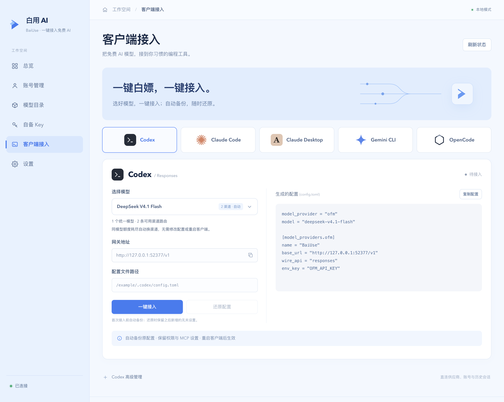
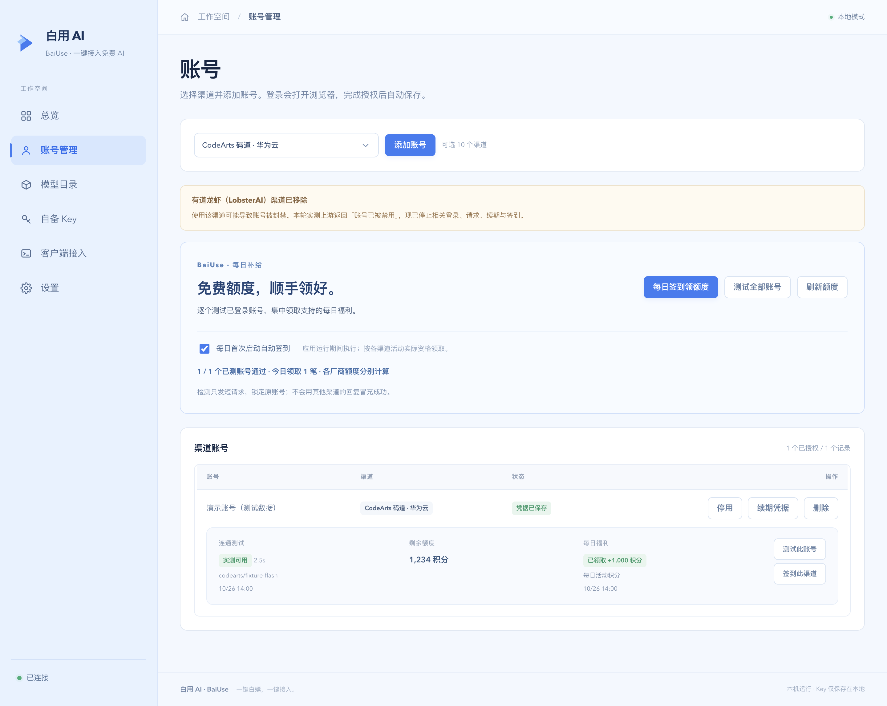

# 白用 AI · BaiUse

## 一键白嫖，一键接入。

**把免费 AI 模型，一键接入你常用的编程工具。**

白用 AI（BaiUse）帮你把各家的免费模型额度用起来。一键接入 Codex、Claude Code、Gemini CLI 和 OpenCode；同模型额度耗尽，自动切换可用渠道，不用反复改配置、切厂商、重启客户端。Claude Desktop 提供应用内接入引导；自备 Key 也能继续用。



> 截图使用隔离的演示数据，不包含真实账号、Key 或个人客户端配置。

## 为什么用白用 AI

不用先研究 API 网关和协议转换：选模型、选工具、点接入，先用起来。同一个模型有多个可用来源时，后续换渠道由 BaiUse 处理。

## 这一版做了什么

- **账号实测与每日补给**：批量测试已登录账号，一键签到、刷新额度；按账号显示真实回复、失败原因和到账回执。支持每日首次启动自动签到。
- **移除有道龙虾渠道**：存在封号风险，本轮实测上游返回「账号已被禁用」，不再提供登录、模型、请求、续期与签到。
- **浅蓝色工作空间**：总览、账号管理、模型目录、自备 Key、客户端接入和设置统一设计。
- **全部使用应用内下拉框**：渠道、筛选、协议和模型选择均支持搜索、键盘选择、Esc 关闭，不再弹出系统选项菜单。
- **渠道名称更容易辨认**：显示产品名、已有中文名及所属厂商，例如 `CodeArts 码道 · 华为云`、`TRAE · 字节跳动`。
- **五类客户端共用模型目录**：账号额度、免登录免费模型和自备 Key，都可用于客户端接入。
- **模型合并与自动换路**：客户端保存稳定模型 ID，不必在每次额度用尽后改厂商配置、重启客户端。
- **配置可预览、可还原**：首次写入前备份，只调整连接、模型和鉴权相关字段，保留无关设置。
- **保留完整请求与输出预算**：网关不主动裁剪上下文、不默认施加原有的 32 MB 请求上限，也不再把显式输出预算静默压至 64K；实际能力仍由上游模型决定。

```text
Codex（桌面版 / CLI） ─┐
Claude Code          ─┤                      ┌─ 已登录的账号渠道
Claude Desktop       ─┼─ BaiUse 一键接入 ─┼─ 免登录免费模型
Gemini CLI           ─┤    统一模型 + 自动换路  └─ 自备 Key / 自定义端点
OpenCode             ─┘
```

## 快速开始

### 环境要求

- Node.js `^22.19.0` 或 `>=24.0.0`，以及 npm。
- 桌面版支持 Electron 可运行的 macOS、Windows、Linux 环境；无图形界面可运行 Node.js 网关。
- 能访问准备使用的上游服务。只需安装自己要接入的客户端，不要求同时安装全部客户端。

### 启动桌面版

```bash
git clone https://github.com/Ningsui0714/baiuse.git
cd baiuse
npm install
npm run start:app
```

如果从带有 `ELECTRON_RUN_AS_NODE` 的开发终端启动，先清除该变量；macOS / Linux 可用 `env -u ELECTRON_RUN_AS_NODE npm run start:app`。

1. 在「账号管理」登录渠道账号，或在「自备 Key」添加供应商。使用免登录免费模型无需先登录渠道账号。
2. 到「模型目录」确认可用模型。目录会异步加载；完成授权后，新渠道模型自动加入。
3. 打开「客户端接入」，选择客户端和模型，查看配置预览。
4. Codex、Claude Code、Gemini CLI、OpenCode 点击「一键接入」后重启相应客户端；Claude Desktop 按下方的应用内流程接入。

网关需要保持运行。默认监听 `127.0.0.1:48760`；端口被占用时会自动选择空闲端口，以界面显示的实际地址为准。

### 仅运行网关

```bash
npm start
# 自定义端口与数据目录
node src/cli.js --port 48760 --data-dir /path/to/data
node src/cli.js --help
```

在浏览器打开日志给出的网关地址加 `/app`，输入启动日志中的本机网关 Key。桌面壳会自动注入该 Key，无需手填。

已有设置时，`node src/cli.js --print-config` 可只打印 Codex 接入配方、不启动服务。首次使用应正常启动一次以保存网关 Key。

## 一键测试与每日签到

在「账号管理」的 **每日补给** 面板中：

- **测试全部账号**：每个已授权、启用的账号发送一次短请求，优先选择轻量或标注免费的模型。锁定原账号与原渠道，不自动换号、换厂商；空响应不算成功。
- **每日签到领额度**：逐渠道领取支持的活动奖励；区分已领取、今日已领、未开放、领取失败、自动发放和需官方手动领取。不同厂商额度不相加，不把重复检查算成新收益。
- **刷新额度**：显示厂商返回的余额、分项和单位；查询失败显示待确认，不冒充余额为零。
- **每日首次启动自动签到**：可开关，应用启动后按渠道包的日计划执行；应用关闭时不会签到。部分活动在北京时间 10:00 开新领取窗口，可再点击按钮补领。
- 每个账号可单独测试，每个渠道可单独签到。小浣熊另有一次性登录奖励入口；ZCode 保留官方领取入口，需要人工验证时在官方完成。



**有道龙虾（LobsterAI）已移除：使用该渠道可能导致账号被封禁。** 本轮实测收到 `40302 账号已被禁用`；该返回证明账号已被上游禁用，不足以单独确定封禁原因。渠道已从登录、目录、路由、自动续期和签到中移除。历史凭据保留在原本机数据中，但不再使用。

实测与活动依据见 [账号测试和签到记录](docs/testing/account-actions-2026-10-26.md)。

## 客户端怎么接

| 客户端 | 接入方式 | 修改范围 |
| --- | --- | --- |
| **Codex** | 一键接入；桌面版与 CLI 共用配置 | `~/.codex/config.toml`；保留官方 `auth.json` 登录态 |
| **Claude Code** | 一键接入 | `~/.claude/settings.json` 中连接、鉴权和模型字段 |
| **Gemini CLI** | 一键接入 | `~/.gemini/.env` 与 `settings.json` |
| **OpenCode** | 一键接入 | 配置目录下新增 `codex-relay` provider，优先使用现有 `opencode.jsonc` |
| **Claude Desktop** | 准备参数 → 在桌面应用内配置 Gateway | 仅保存本地模型映射，不自动改写桌面应用部署配置 |

以上为默认路径；支持的客户端目录环境变量见 [接入说明](docs/client-integrations.md)。配置预览默认掩码敏感字段，点击复制时才读取完整内容。首次文件式接入前自动备份；还原时保留后来新增的无关设置，若连接字段已被其他程序改动则提示冲突，不覆盖现有内容。

### Claude Desktop 必须在应用内配置

Claude Desktop 的第三方推理配置与 Claude Code CLI 的 `settings.json` 不是同一套配置。

1. 在 BaiUse 中选 **Claude Desktop** 和模型，点击 **准备接入参数**。
2. 在 Claude Desktop 中打开 **Help → Troubleshooting → Enable Developer Mode**，按提示重启。
3. 打开 **Developer → Configure Third-Party Inference**，选择 **Gateway**。
4. 复制 BaiUse 提供的 Gateway 地址、本机 Key、模型 ID；选择 **Static API key / Bearer**。
5. 在桌面应用内测试连接、应用设置，并按提示重启。安装版本和组织策略可能影响入口。

Gateway 地址是实际网关地址加 `/claude-desktop`，不要额外追加 `/v1`。桌面可识别别名 `claude-sonnet-4-5` 会映射到选定的真实模型；别名不表示上游模型就是 Claude。

「参数已准备」只表示本地映射已保存；「检测到网关请求」只表示网关观测到成功请求，均不冒充桌面应用内部配置状态。撤销桌面接入时，需回到应用内移除 Gateway 设置。

### 手动配置 Codex

也可以自行编辑 `~/.codex/config.toml`：

```toml
model_provider = "ofm"
model = "deepseek-v4.1-flash" # 换成当前模型目录中实际存在的 ID

[model_providers.ofm]
name = "BaiUse"
base_url = "http://127.0.0.1:48760/v1"
wire_api = "responses"
env_key = "OFM_API_KEY"
```

运行 CLI 的终端需设置 `OFM_API_KEY` 为本机网关 Key；端口不同则同步修改地址。桌面版推荐直接使用界面「一键接入」，避免遗漏鉴权配置。

「Codex 高级管理」中的第三方直连档案会绕过 BaiUse；需要自动换路时应使用本机网关，而非某一家直连档案。

## 同一模型，不再按厂商分开选

例如下面三种上游标识会归入同一模型：

```text
codearts/deepseek-v4.1-flash      ┐
trae/DeepSeek V4.1 Flash 1017    ├─ deepseek-v4.1-flash
…/deepseek-v4.1-flash-20261017   ┘
```

这是等价标识示例，不表示这些渠道在你的账号中都已授权或都提供该模型。主版本、模型档位和不同调优版本仍区分：**V4 ≠ V4.1，Flash ≠ Pro**。

- 客户端写入统一模型 ID；网关内部保留真实厂商模型 ID，并按实际可用渠道发送请求。
- 配额耗尽、限流或可重试错误出现时，在尚未输出正文或工具参数前切换到其他匹配渠道。
- 每条候选线路每轮最多尝试一次，不再默认只尝试四条。已开始输出后不把其他模型回答拼接进来。
- 新授权渠道动态加入；同一模型新增或切换备用线路无需改客户端配置、无需重启客户端。
- 旧 `codearts/...` 等带厂商前缀的配置仍可匹配同模型备用渠道。
- 是否有备用取决于实际可用账号与目录，选择框会显示渠道数量；只有一条时不会凭空产生备用。

实现与验证见 [模型池记录](docs/testing/model-pools-2026-10-26.md)。

## 渠道名称与厂商

账号渠道展示名称与底层标识分离。搜索支持产品英文名、已有中文名、厂商中文名和原始 ID；登录、账号关联和路由仍使用原始 ID。

| 标识 | 界面名称 | 所属厂商 |
| --- | --- | --- |
| `codearts` | CodeArts 码道 | 华为云 |
| `qoder` | Qoder | 阿里云 |
| `qodercn` | Qoder CN 中国版 | 阿里云 |
| `trae` | TRAE | 字节跳动 |
| `cline` | Cline | Cline Bot |
| `loomy` | Loomy | 科大讯飞 |
| `raccoon` | Raccoon 小浣熊 | 商汤科技 |
| `minimax` | MiniMax Code | MiniMax |
| `gemini` | Gemini Code Assist | 谷歌 Google |
| `zcode` | ZCode | 智谱 AI |

名称映射和来源见 [渠道名称说明](docs/design/channel-labels.md)。不硬造没有官方中文名的产品译名；未来未知渠道保留原始标识。账号渠道是否显示、能否登录，以运行时实际启用情况为准。

上游 Gemini 账号登录需自行配置 `CMDC_PAK_GOOGLE_CLIENT_ID` / `CMDC_PAK_GOOGLE_CLIENT_SECRET`；Loomy 微信登录需 `CMDC_PAK_LOOMY_WECHAT_APP_ID`。仓库不内置这几项共享 OAuth 配置。这与 **Gemini CLI 作为下游客户端接入 BaiUse** 是两件事，后者不需要上游 Google OAuth 客户端配置。

## 免费来源与用量

| 来源 | 需要什么 | 用量由谁决定 |
| --- | --- | --- |
| 免登录免费模型 | 无需上游账号或 Key | 当前由 Kilo 免费池提供，仅使用上游标记为免费的模型；限流与可用性由上游决定 |
| 账号渠道 | 登录自己的渠道账号 | 对应账号的免费额度、套餐与服务规则 |
| 自备 Key | 自己的厂商 Key 或兼容端点 | 对应供应商计费与配额 |

BaiUse 的本机网关 Key 用于客户端连接本地服务，不是厂商 API Key。免费池不等于无限额度；对话会发送给所选上游，Kilo 免费池可能记录提示词用于改进服务。

网关保留完整输入、工具结果和显式输出预算；真正达到上游输出长度限制时返回截断状态，不伪装成完整回答。令牌估算接口采用本地启发式估算，并通过 `x-relay-token-count: estimated` 标注，不作为上游计费依据。

## API

除 `/health` 和静态管理页面外，推理接口需要本机网关 Key。

| 接口 | 用途 |
| --- | --- |
| `GET /health` | 网关状态 |
| `GET /v1/models` | 统一模型目录 |
| `POST /v1/responses` | Responses，流式 / 非流式 |
| `POST /v1/chat/completions` | OpenAI Chat 兼容协议 |
| `POST /v1/messages` | Anthropic Messages 兼容协议 |
| `POST /claude-desktop/v1/messages` | Claude Desktop 模型映射入口 |
| `POST /v1beta/models/:model:generateContent` | Gemini 非流式 |
| `POST /v1beta/models/:model:streamGenerateContent` | Gemini SSE |
| `GET /app` | 管理界面；管理 API 另行鉴权 |

支持文本、图片、自定义工具调用、参数分片、工具结果回传和用量转换。音视频、供应商服务端工具等扩展并非完整兼容；不支持的内容返回明确错误，不静默丢弃。完整约定见 [客户端接入说明](docs/client-integrations.md)。

## 数据与恢复

- 默认只监听回环地址；管理 API 检查本机来源与 Bearer Key。
- macOS 默认数据目录：`~/Library/Application Support/OFM Codex Gateway/`。
- 其他系统：`$XDG_CONFIG_HOME/ofm-codex-gateway/` 或 `~/.config/ofm-codex-gateway/`。
- 用 `--data-dir` 或 `OFM_GATEWAY_HOME` 指定其他目录。
- 数据目录包含网关 Key、渠道凭据及配置备份，不应提交到版本库。账号诊断、签到回执保存在 `account-actions.json`（权限 `0600`），不保存凭据；自动签到设置沿用渠道包的 `channel-pack/auto-checkin.json`。

项目已从 Codex Relay 更名为 **白用 AI · BaiUse**，项目标识为 `baiuse`。GitHub 仓库已更名为 `Ningsui0714/baiuse`；已有 CLI 命令 `codex-relay`、OpenCode provider ID `codex-relay`、运行时标识 `ofm`、`OFM_API_KEY`、`OFM_GATEWAY_HOME` 和原数据目录继续保留，避免升级后配置失效。

普通客户端接入不修改 Codex 官方登录态。高级管理里的「记录当前登录 / 切换账号」是单独操作，会管理 `auth.json`；不要与网关接入混淆。

## 开发、测试与当前验证范围

```bash
npm test          # 单元与集成测试
npm run test:e2e  # 本地 429 → 备用渠道端到端测试
npm run test:ui   # 隔离的真实 Electron 页面交互测试，需要图形环境
npm run dist     # macOS 目录版
npm run dist:all # 多平台打包，取决于本机工具链
```

本版验证（2026-10-26）：

- **224 项单元 / 集成测试通过，63 项 Electron 下拉与页面检查通过。**
- 本轮 8 个已登录渠道分别测试；移除有道龙虾后，7 个保留渠道中 6 个已获真实回复，ZCode 的 Flash 无正文、普通版并发限流。MiniMax 签到领取 400 积分后恢复回复，Qoder 中国版领取 100 credits。该结果不代表每个渠道的所有模型均可用。
- 真实 CodeArts / DeepSeek 对话、Responses SSE、Messages、Chat、Gemini 接口已验证；真实 Codex CLI 文本和终端工具闭环通过。
- 多厂商配额切换通过本地 CodeArts → TRAE 夹具验证，覆盖五类协议；不宣称已使用未授权的真实 TRAE 账号。
- Claude Code、Gemini CLI、OpenCode 已验证配置和协议层；尚未声称完成这些原生进程及 Claude Desktop 应用内的完整对话验收。
- 账号渠道强制 `tool_choice` 仍有兼容性限制，自动工具调用已实测。

详见 [真实 DeepSeek 实测](docs/testing/deepseek-live-2026-10-26.md)、[模型池验证](docs/testing/model-pools-2026-10-26.md)、[界面验收](docs/design/README.md)。

```text
electron/     桌面壳与 preload
ui/           浅蓝管理页面、共享下拉框、渠道名称与接入向导
src/clients/  客户端配置、备份还原、协议转换与 Responses 事件
src/channels/ 账号渠道运行时与凭据状态
src/models.js 统一模型标识与模型池
vendor/       渠道、车道和供应商预设
test/         本地端到端与 Electron 页面测试
docs/         接入说明、设计与验证记录
```

## 许可

项目自有代码采用 [MIT License](LICENSE)。`vendor/` 中的渠道适配代码源自 [dsh-our-free-model](https://github.com/Ebony-Vinyl/dsh-our-free-model) 及其上游，仍受各自许可约束。产品名与商标归各自权利人所有；本项目不是这些厂商的官方客户端。
